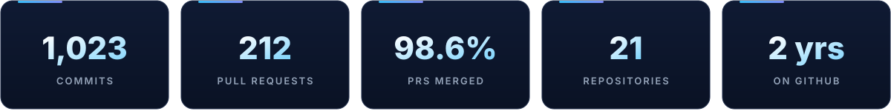
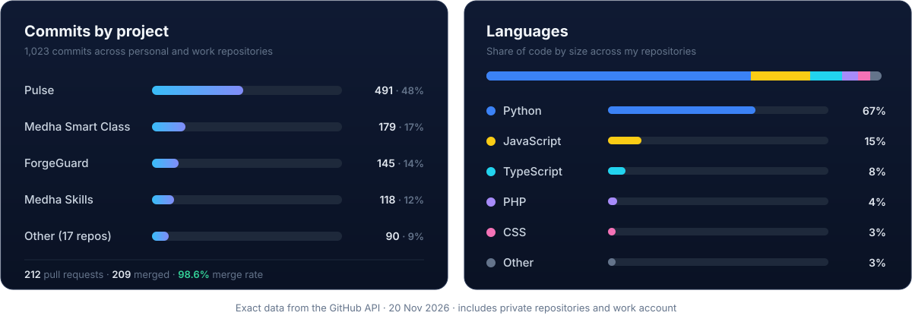

<!-- ═══════════════════════════════ HEADER ═══════════════════════════════ -->

 

  

<!-- ═══════════════════════════════ ABOUT ═══════════════════════════════ -->

## About Me

I'm a **Computer Science Engineer** who builds intelligent systems and ships them to production. My work sits where **AI/ML**, **Generative AI & agentic workflows**, and **reliable backend engineering** meet. I like taking a messy, real-world problem all the way to a deployed product.

<table>
  <tr>
    <td width="50%" valign="top">

**What I do**

- **Generative AI & Agents:** LangGraph / LangChain workflows, RAG, and Gemini, Groq, OpenAI and Claude integrations
- **Computer Vision & Deep Learning:** deepfake forensics, classification, predictive models
- **Document Intelligence:** OCR, PDF parsing and LLM-based structured extraction
- **Backend & APIs:** FastAPI, Django REST, Flask and Express, on PostgreSQL and MongoDB
- **Frontend:** React 19, TypeScript, Vite and Tailwind

</td>
    <td width="50%" valign="top">

**Currently**

- **AI / Full-Stack Engineer at Cograd:** building the Medha education platforms
- **Building Pulse:** an NSE options research and paper-trading platform
- **Building Personal Asset OS:** an AI warranty and ownership vault
- **Learning:** agentic AI, LLM evaluation and production MLOps

</td>
  </tr>
</table>

<!-- ═══════════════════════════════ EXPERIENCE ═══════════════════════════════ -->

## Professional Experience

### Cograd &nbsp;·&nbsp; AI / Full-Stack Engineer &nbsp;·&nbsp; Oct 2026 – Present

<table>
  <tr>
    <td width="50%" valign="top">

#### Medha Smart Class
AI education platform &nbsp;·&nbsp; 179 commits

Generates **NCERT-aligned, culturally aware lesson and activity plans** for teachers in Classes 1–12, using local context from 700+ districts across India.

- Built and extended **RAG pipelines** using vector embeddings over the NCERT curriculum, with GPT-4 and Claude for generation
- Worked across the **FastAPI** backend, the **Express** auth service and the **React + TypeScript** frontend
- Reduced LLM **token usage and cost** across generation flows

`Python` `FastAPI` `LangChain` `OpenAI` `Claude` `MongoDB Vector Search` `React` `TypeScript` `Azure`

</td>
    <td width="50%" valign="top">

#### Medha Skills
Skills & career-readiness platform &nbsp;·&nbsp; 118 of 132 commits (main contributor)

A spin-off of Medha focused on **student skills and career readiness**, built and maintained largely by me.

- **AI assistant rebuild:** streaming chat with server-side history, file uploads, previews and **in-chat image generation**
- **Career Ready module:** a **hands-free mock interview** with speech-to-text, AI feedback reports and feature-flagged rollout
- Tested every feature, including error paths and failure cases, and documented each change

`Python` `FastAPI` `LLMs` `Speech-to-Text` `React` `TypeScript` `Cosmos DB` `Azure`

</td>
  </tr>
</table>

<!-- ═══════════════════════════════ PROJECTS ═══════════════════════════════ -->

## Featured Projects

<table>
  <tr>
    <td width="50%" valign="top">

### [ForgeGuard](https://github.com/pushkaranand07/Forgegard)
Deepfake and manipulated-media detection with multi-stage inference over images and video. **94%+ accuracy** with EfficientNet-B7 and MTCNN face extraction.

`PyTorch` `EfficientNet-B7` `MTCNN` `OpenCV` `Django`

</td>
    <td width="50%" valign="top">

### [RoomPilot AI](https://github.com/pushkaranand07/Room-Piolet)
Conversational meeting-room booking agent: natural-language requests, multi-turn context, room matching, conflict detection and alternative suggestions.

`LangGraph` `Gemini` `Groq` `Flask` `React` `Vite`

</td>
  </tr>
  <tr>
    <td width="50%" valign="top">

### [Smart Book Reader](https://github.com/pushkaranand07/Smart_Book_Reader)
Document intelligence for textbooks and scanned PDFs: page classification, graph extraction and grounded Q&A. Cut manual analysis effort by **90%**.

`FastAPI` `PyTorch` `Transformers` `OCR` `React` `Docker`

</td>
    <td width="50%" valign="top">

### Pulse
NSE options research and paper-trading platform: live option chain, volatility regimes, a multi-agent LLM debate, and a strategist that ranks defined-risk option candidates. Tested across **1,500+ backtest trials**. Research only, places no orders.

`Python` `FastAPI` `Pandas` `Parquet` `LLM Agents` `Docker`

</td>
  </tr>
  <tr>
    <td width="50%" valign="top">

### Personal Asset OS
AI warranty and ownership vault: OCR and LLM extraction from invoices and receipts, a warranty-expiry engine, email reminders and a private document store.

`FastAPI` `PostgreSQL` `PyMuPDF` `OCR` `React` `TypeScript`

</td>
    <td width="50%" valign="top">

### [AnimeStreamer](https://github.com/pushkaranand07/anime-stremer)
Full-stack anime and manga discovery platform with a resilient multi-tier catalog architecture.

`React 19` `Vite` `Django REST Framework` `CSS Modules`

</td>
  </tr>
</table>

<b>More projects</b>

 

| Project | Description | Stack |
| :--- | :--- | :--- |
| [HeartGuard](https://github.com/pushkaranand07/Heart-Defects-Prediction-using-ML-) | Heart-disease risk prediction with **95% accuracy** and interactive medical dashboards | `Scikit-Learn` `Streamlit` `Plotly` |
| Personal Vault | Collection manager with automatic metadata and image lookup, Excel export and AI fill-in (private) | `FastAPI` `React` `TypeScript` `Claude` |
| [InstaFood](https://github.com/pushkaranand07/Food-recipes) | Recipe app with ingredient search, dietary tags and JWT authentication | `React 19` `Django REST` `JWT` |
| [File Reader](https://github.com/pushkaranand07/File_Reader) | Django web app for uploading and reading documents | `Django` `JavaScript` `SQLite` |
| [PDF Editor for WhatsApp](https://github.com/pushkaranand07/pdf_editor_whatsapp) | Tool for editing and preparing PDFs to share on WhatsApp | `Python` `JavaScript` |

Private repositories: happy to walk through the code or give a demo on request.

<!-- ═══════════════════════════════ TECH STACK ═══════════════════════════════ -->

## Tech Stack

<table>
  <tr>
    <td align="right" width="170"><b>Languages</b></td>
    <td></td>
  </tr>
  <tr>
    <td align="right"><b>AI & ML</b></td>
    <td>
       
      
      
      
      
      
      
      
      
      
      
    </td>
  </tr>
  <tr>
    <td align="right"><b>Backend</b></td>
    <td></td>
  </tr>
  <tr>
    <td align="right"><b>Frontend</b></td>
    <td></td>
  </tr>
  <tr>
    <td align="right"><b>Databases</b></td>
    <td></td>
  </tr>
  <tr>
    <td align="right"><b>Cloud & DevOps</b></td>
    <td></td>
  </tr>
</table>

<!-- ═══════════════════════════════ ANALYTICS ═══════════════════════════════ -->

## GitHub Analytics

  

<!-- ═══════════════════════════════ FOOTER ═══════════════════════════════ -->

 

**Open to AI/ML and backend engineering opportunities.** 
Reach me on [LinkedIn](https://www.linkedin.com/in/pushkar-anand-905aa829) or at [regaranand07@gmail.com](mailto:regaranand07@gmail.com).

